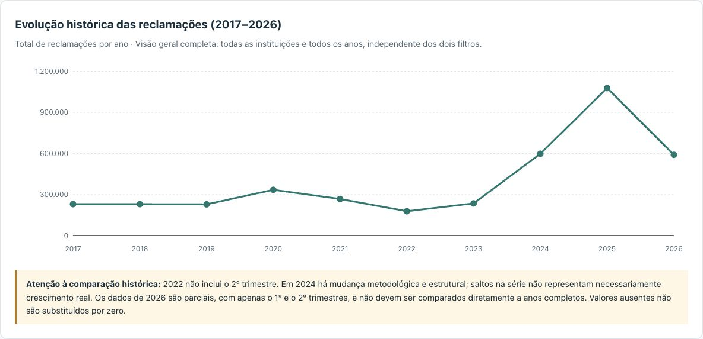
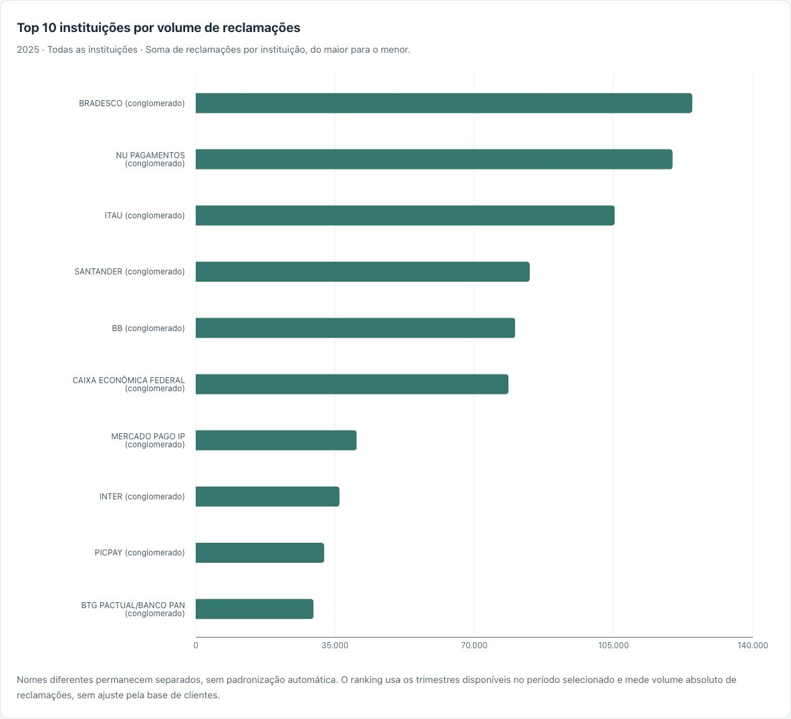
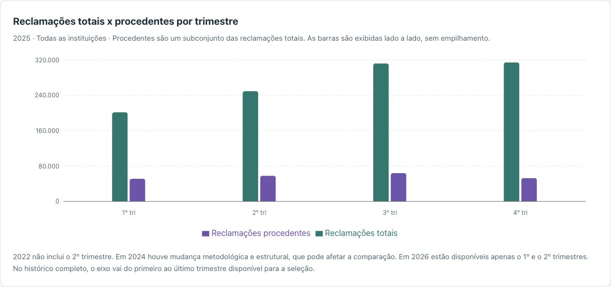

# Dashboard de Reclamações Bancárias — BCB


Projeto de portfólio em Dados/BI que transforma uma base histórica de reclamações bancárias em indicadores e visualizações interativas. A aplicação permite explorar volumes, procedência e evolução temporal, com filtros por ano e instituição financeira.

**[Acessar o dashboard publicado](https://dashboard-reclamacoes-bcb.vercel.app/)**

## Apresentação e objetivo analítico

O objetivo é apoiar a exploração de três perguntas: como o volume de reclamações varia ao longo do tempo, quais instituições concentram os maiores volumes e qual parcela das reclamações é procedente no período selecionado.

O projeto reúne validação de dados, agregações, definição de KPIs e comunicação visual. Esses procedimentos também se aplicam a análises de produtividade de esteiras, concentração de operações e acompanhamento de indicadores operacionais. O ranking apresentado mede volume absoluto; não constitui uma avaliação isolada da qualidade de uma instituição.

## Prévia visual

As imagens abaixo são capturas reais do [dashboard publicado](https://dashboard-reclamacoes-bcb.vercel.app/), realizadas em 2 de novembro de 2026. O ranking e a comparação trimestral mostram **2025, com todas as instituições**; a evolução histórica sempre apresenta a base completa.



*Evolução histórica: visão geral dos totais anuais, com observações sobre cobertura e mudanças metodológicas.*



*Ranking: dez maiores volumes de reclamações em 2025, sem unificação automática de nomes.*



*Comparação trimestral: barras lado a lado para o total de reclamações e seu subconjunto de reclamações procedentes.*

## Funcionalidades e indicadores

- Filtro anual de 2017 a 2026 e opção **Todos os anos (2017–2026)**; seleção inicial em **2025**.
- Filtro por instituição financeira, incluindo **Todas as instituições**, combinado ao filtro anual.
- Quatro KPIs, ranking e comparação trimestral atualizados pelos filtros.
- Evolução histórica independente dos dois filtros, mantendo a visão geral completa.
- Números em pt-BR, tooltips, legenda e interface responsiva; gráficos extensos têm rolagem horizontal em telas menores.
- Estados de carregamento, erro com nova tentativa e ausência de registros.

| Indicador | Fórmula | Regra de interpretação |
| --- | --- | --- |
| Total de reclamações | `Σ total_reclamacao` | Soma dos registros do período e da instituição selecionados. |
| Reclamações procedentes | `Σ procedentes` | Subconjunto do total, não reclamações não procedentes. |
| Taxa de procedência | `100 × Σ procedentes / Σ total_reclamacao` | Razão entre somas; não é a média simples de percentuais. |
| Variação anual de procedentes | `100 × (P_atual / P_anterior − 1)` | Ambos os valores usam os mesmos trimestres disponíveis nos dois anos, para a mesma seleção de instituição. |

Na última fórmula, `P_atual` e `P_anterior` representam as somas de procedentes nos trimestres comuns. Em 2026, a comparação usa o primeiro semestre de 2025. Na comparação de 2023 com 2022, considera somente o 1º, 3º e 4º trimestres. Os outros três KPIs continuam usando toda a cobertura disponível no ano selecionado.

No histórico acumulado, os três primeiros KPIs usam toda a seleção, mas a variação anual é **N/D**, pois não existe uma comparação anual única. Ausência de registros, valores ausentes nas medidas necessárias, falta de trimestres equivalentes ou denominador zero também tornam o cálculo afetado indisponível.

## Fonte, período e estrutura dos dados

A referência é o [Ranking de Reclamações do Banco Central do Brasil](https://www.bcb.gov.br/meubc/rankingreclamacoes). A aplicação utiliza a base consolidada [reclamacoes_historico.csv](dashboard/public/data/reclamacoes_historico.csv), incluída no repositório; não consulta o BCB em tempo real. O histórico de preparação da base foi associado ao projeto [Churn Bancário Brasil](https://github.com/thalesfreirefarias/churn-bancario-brasil); a rotina de preparação não faz parte desta aplicação.

O arquivo atual contém **5.060 registros**, **556 nomes distintos de instituições** e referências de **2017 ao 2º trimestre de 2026**. Cada registro corresponde à combinação de ano, trimestre e nome de instituição ou conglomerado. Nomes distintos não equivalem necessariamente a entidades econômicas distintas ao longo do tempo.

| Campo no CSV | Tipo após leitura | Descrição |
| --- | --- | --- |
| `ano` | Número inteiro | Ano de referência. |
| `trimestre` | Número inteiro de 1 a 4 | O texto original, como `1º`, é convertido para ordenação. |
| `instituicao` | Texto | Nome informado na base. |
| `procedentes` | Inteiro ou `null` | Quantidade de reclamações procedentes. |
| `total_reclamacao` | Inteiro ou `null` | Total de reclamações; no código, `totalReclamacao`. |
| `total_cliente` | Inteiro ou `null` | Base de clientes; no código, `totalCliente`. Não compõe os KPIs atuais. |
| `estrutura` | Categoria | `antiga`, `nova_1` ou `nova_2`. |

A estrutura `antiga` vai até o 1º trimestre de 2024; `nova_1` aparece no 2º trimestre de 2024; `nova_2`, do 3º trimestre de 2024 em diante. O CSV já reúne essas versões nas mesmas colunas, mas isso não comprova equivalência metodológica dos conceitos originais.

O parser verifica colunas obrigatórias, números inteiros não negativos, identificação dos períodos, chaves duplicadas e casos em que procedentes excedem o total. O arquivo contém 16 ausências em `total_cliente`, preservadas como `null`.

## Os três gráficos

### Evolução histórica das reclamações

Gráfico de linhas com a soma de `total_reclamacao` por ano. Exibe 2017 a 2026 independentemente dos filtros, para manter uma referência geral da série. A escolha de linhas favorece a leitura temporal, mas as mudanças de cobertura impedem interpretar toda oscilação como crescimento ou queda real.

### Top 10 instituições por volume de reclamações

Barras horizontais com agrupamento pelo nome de `instituicao`, soma das reclamações e ordenação decrescente. São exibidos os dez maiores totais da seleção; empates são ordenados pelo nome. Nomes diferentes permanecem separados.

Com uma instituição selecionada, o gráfico mostra somente sua barra e explica a restrição do filtro. Grupos com valores ausentes em `total_reclamacao` são excluídos da classificação com aviso, evitando apresentar somas parciais como totais completos.

### Reclamações totais x procedentes por trimestre

Barras agrupadas, com duas cores e legenda. Para um ano, soma as medidas por trimestre; em **Todos os anos**, agrega por ano e trimestre em ordem cronológica.

As séries não são empilhadas: procedentes já estão contidas no total. No histórico completo, o eixo vai do primeiro ao último período observado na seleção, mantendo lacunas internas como `null`. Para um ano individual, os quatro trimestres ficam identificados, mesmo quando não há dados para todos.

## Tecnologias

| Tecnologia | Uso no projeto |
| --- | --- |
| React 19 | Interface, estado dos filtros e composição de componentes. |
| TypeScript 5.9 | Tipagem dos registros, filtros e funções de cálculo. |
| Vite 8 | Servidor de desenvolvimento e build de produção. |
| Papa Parse 5 | Leitura do CSV com cabeçalho e tratamento de erros. |
| Recharts 3 | Gráficos responsivos, eixos, legendas e tooltips. |
| CSS | Layout, identidade visual e adaptação a telas menores. |
| Node.js / `node:test` | Execução dos testes automatizados. |
| ESLint | Análise estática de código e regras para React. |
| Git, GitHub e Vercel | Versionamento, repositório e hospedagem. |

As versões e os comandos estão definidos em [dashboard/package.json](dashboard/package.json), com resolução de dependências em `dashboard/package-lock.json`. Python/Pandas e SQL são referências para aprofundamento das análises; não são dependências de execução desta aplicação.

## Arquitetura e estrutura de pastas

A aplicação é um front-end estático, sem API própria ou banco de dados. O navegador carrega o CSV por `fetch`, o Papa Parse faz a leitura, as funções de domínio validam e agregam os registros e o React atualiza KPIs e gráficos. As visualizações são carregadas por importação dinâmica com `lazy` e `Suspense`, separando os gráficos do bundle inicial.

```text
dashboard-reclamacoes-bcb/
├── README.md
├── docs/imagens/                         # Capturas reais da versão publicada
└── dashboard/                           # Raiz da aplicação e dos comandos npm
    ├── public/data/reclamacoes_historico.csv
    ├── src/
    │   ├── main.tsx                     # Inicialização do React
    │   ├── App.tsx                      # Carregamento, filtros e KPIs
    │   ├── App.css / index.css          # Estilos
    │   ├── lib/reclamacoes.ts           # Parser, validações e agregações
    │   └── components/
    │       ├── Visualizacoes.tsx
    │       ├── EvolucaoHistorica.tsx
    │       ├── RankingInstituicoes.tsx
    │       └── ReclamacoesTrimestrais.tsx
    ├── tests/reclamacoes.test.mjs
    ├── package.json / package-lock.json
    ├── vite.config.ts
    └── vercel.json
```

A árvore destaca os arquivos relevantes à aplicação. Eventuais arquivos npm na raiz do repositório não substituem o pacote de `dashboard`; execute os comandos de instalação e desenvolvimento dentro dessa pasta.

### Exemplos reais do código

Em [src/lib/reclamacoes.ts](dashboard/src/lib/reclamacoes.ts), a leitura mantém o cabeçalho e ignora linhas vazias:

```typescript
const resultado = Papa.parse<Record<string, string>>(texto, {
  header: true, skipEmptyLines: 'greedy', transformHeader: (nome) => nome.trim(),
})
```

Depois dessa leitura, o código verifica os erros do parser e valida cada registro. A função de soma abaixo distingue ausência de informação de zero real:

```typescript
export function somar(registros: Reclamacao[], campo: 'procedentes' | 'totalReclamacao'): number | null {
  if (!registros.length || registros.some((registro) => registro[campo] === null)) return null
  return registros.reduce((soma, registro) => soma + (registro[campo] as number), 0)
}
```

Se qualquer registro do grupo tiver a medida ausente, o agregado correspondente fica indisponível. O zero inicial do `reduce` é apenas o acumulador da soma, após a checagem; não substitui valores ausentes.

Em [EvolucaoHistorica.tsx](dashboard/src/components/EvolucaoHistorica.tsx), o agrupamento anual é expresso pela seleção dos registros de cada ano seguida da soma:

```typescript
const historico = anos.map((ano) => ({
  ano,
  total: somar(dados.filter((registro) => registro.ano === ano), 'totalReclamacao'),
}))
```

Essa lógica se relaciona a `groupby` e `sum` no Pandas, ou `GROUP BY` e `SUM` no SQL. Aqui, ela é executada em TypeScript sobre os registros carregados do CSV.

## Instalação e execução local

Use **Node.js 24.x**, versão utilizada na validação do projeto, npm e Git. O teste importa diretamente um arquivo TypeScript usando o suporte nativo do Node; versões antigas podem não executar esse comando corretamente.

```bash
git clone https://github.com/thalesfreirefarias/dashboard-reclamacoes-bcb.git
cd dashboard-reclamacoes-bcb
cd dashboard
npm install
npm run dev
```

Abra a URL exibida pelo Vite no terminal, normalmente `http://localhost:5173`. Se a porta estiver ocupada, o servidor informa outra. O CSV já está em `public/data`; não é necessário configurar credenciais, banco de dados ou uma conta de IA.

O código desenvolvido com auxílio do Codex é executado como qualquer aplicação React: clone o repositório, instale as dependências e inicie o servidor. O Codex não é necessário em tempo de execução. Para adaptar o projeto, edite os arquivos locais, confira os resultados na interface e execute as validações abaixo.

## Testes e verificações

Na pasta `dashboard`:

```bash
npm run test
npm run lint
npm run build
```

| Comando | O que verifica |
| --- | --- |
| `npm run test` | Executa sete testes com `node:test`, sobre o CSV real e cenários de borda. |
| `npm run lint` | Executa o ESLint; não substitui testes de comportamento. |
| `npm run build` | Verifica o TypeScript e gera a aplicação estática em `dist`. |

Os testes cobrem a estrutura do CSV, 6.127 combinações de filtros, coerência entre agregações, comparação anual com trimestres comuns, nomes distintos, ausência de registros, valores ausentes, base zero, lacunas temporais e rejeição de dados inválidos ou duplicados. Não constituem uma auditoria da metodologia original do BCB nem uma suíte automatizada de interface.

Para inspecionar o build localmente, execute `npm run preview` depois do build e abra a URL informada. Mudanças de layout também devem ser conferidas em telas menores e com nomes longos de instituições.

## Como salvar e publicar alterações no GitHub

Após revisar as mudanças e executar as verificações, retorne da pasta `dashboard` para a raiz do repositório:

```bash
cd ..
git status
git diff
git add README.md docs/imagens dashboard
git diff --cached
git commit -m "Atualiza dashboard e documentação do projeto"
git push origin main
```

O exemplo considera a branch `main` e o remoto `origin` deste repositório. O `git add` prepara os arquivos, o `git commit` registra a versão local e o `git push` envia os commits ao GitHub, mediante autenticação. Revise a seleção antes do commit; dependências instaladas e artefatos de build não devem ser versionados.

Enviar ao GitHub e publicar um site são ações distintas. Se houver integração de deploy automático com a Vercel, um push para a branch configurada poderá iniciar uma publicação.

A configuração da aplicação para Vercel é **Root Directory: `dashboard`**, **Build Command: `npm run build`** e **Output Directory: `dist`**. O arquivo [vercel.json](dashboard/vercel.json) declara o framework Vite, o comando e a saída; a raiz deve ser selecionada no painel da hospedagem.

## Metodologia e limitações

| Tema | Cuidado necessário |
| --- | --- |
| 2022 sem Q2 | O 2º trimestre está ausente. O total anual cobre apenas o 1º, 3º e 4º trimestres; não é um ano completo. |
| Mudanças em 2024 | Há três estruturas no mesmo ano. A equivalência das definições originais ainda exige validação; a comparação numérica não garante comparabilidade metodológica. |
| 2026 parcial | Há somente Q1 e Q2. Comparar com 2025 completo distorce a interpretação; a variação anual usa os mesmos trimestres. |
| Nomes não normalizados | Grafias e nomes diferentes ficam separados, sem conciliação de mudanças societárias ou conglomerados. |
| Valores ausentes | São `null`, nunca zero artificial. Medidas afetadas aparecem como N/D; lacunas permanecem identificadas nas séries. |
| Períodos equivalentes | A variação usa a interseção dos trimestres disponíveis nos dois anos. Com uma instituição selecionada, essa cobertura é verificada para o mesmo nome. |
| Volume e clientes | O ranking não ajusta por porte ou base de clientes. `total_cliente` não deve ser somado entre trimestres como se representasse pessoas únicas. |
| Atualização | A base é um arquivo estático versionado, sem atualização automática ou garantia de conter toda publicação posterior do BCB. |

Procedentes são parte do total, portanto somar as duas séries geraria dupla contagem. Da mesma forma, uma taxa agregada deve usar a razão entre somas, em vez da média simples das taxas de cada instituição.

Os gráficos permitem análise descritiva da cobertura disponível. Eles não demonstram causalidade, não identificam clientes únicos e não sustentam, isoladamente, uma conclusão de melhora ou piora de atendimento.

## Desenvolvimento com auxílio do Codex

O Codex foi utilizado como ferramenta de apoio para implementação da interface, funções de cálculo, testes, revisão e documentação. As solicitações incluíram regras explícitas sobre dados ausentes, períodos equivalentes e preservação dos nomes das instituições.

O uso da ferramenta não comprova domínio autônomo de toda a stack. O projeto registra uma experiência prática de construção e revisão assistida, com conceitos que ainda serão aprofundados em exercícios de Python/Pandas e SQL, reproduzindo agrupamentos, somas, rankings e comparações temporais. A responsabilidade pela interpretação e pela revisão das entregas continua humana.

## Desafios e aprendizados técnicos

- **Traduzir perguntas em indicadores:** definir numeradores, denominadores e períodos antes de escolher a visualização.
- **Distinguir ausência de zero:** preservar lacunas e evitar totais ou taxas artificialmente reduzidos.
- **Controlar o contexto dos filtros:** atualizar KPIs, ranking e comparação trimestral, mantendo a evolução histórica como referência geral.
- **Organizar séries temporais:** usar ano e trimestre para manter ordem cronológica e comparação coerente.
- **Escolher gráficos e comunicar limites:** linhas para evolução, barras horizontais para ranking e barras agrupadas para comparar total e subconjunto.
- **Separar responsabilidades:** manter validações e agregações fora dos componentes visuais e conferir os resultados com testes independentes.
- **Preparar a entrega:** validar o build, separar o carregamento dos gráficos e documentar comandos reproduzíveis.

Esses aprendizados são transferíveis a painéis de operações e BI, mas exigem prática adicional e validação no contexto de cada negócio.

## Possíveis melhorias

- Documentar a origem de cada arquivo e o mapeamento entre estruturas do BCB, validando a comparabilidade histórica.
- Criar um cadastro de instituições com identificadores e regras documentadas de normalização.
- Reproduzir as análises em notebooks de Python/Pandas e consultas SQL para aprofundamento e conferência independente.
- Automatizar a atualização da base com verificações de qualidade e registro da data de referência.
- Adicionar busca de instituições, exportação dos dados filtrados e alternativas tabulares acessíveis aos gráficos.
- Ampliar testes de interface e acessibilidade, configurar integração contínua e acompanhar atualizações e alertas das dependências.
