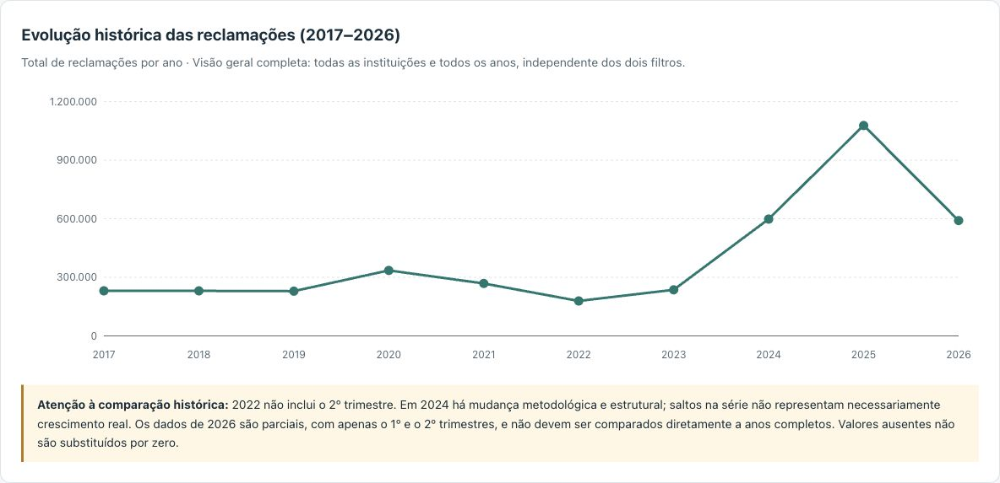
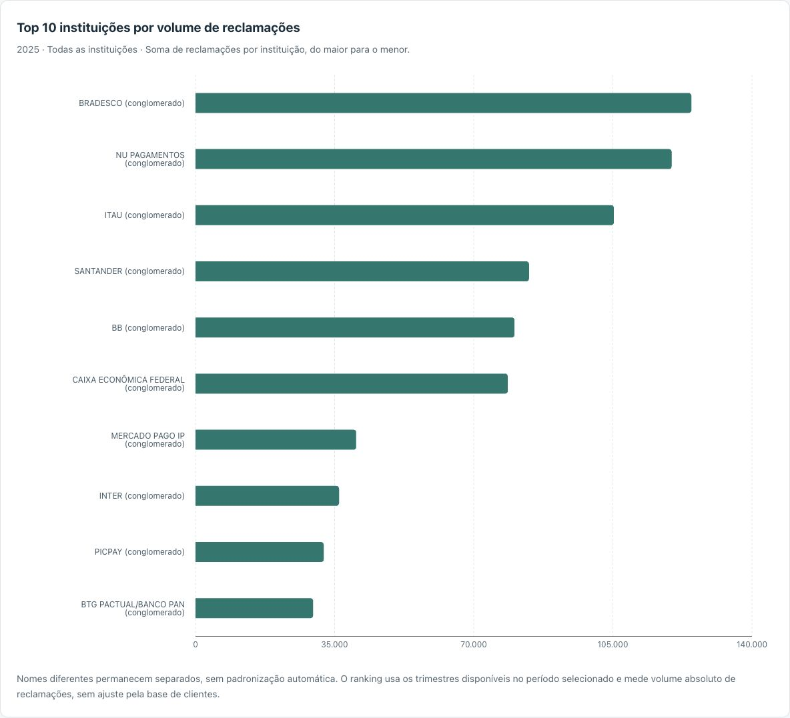
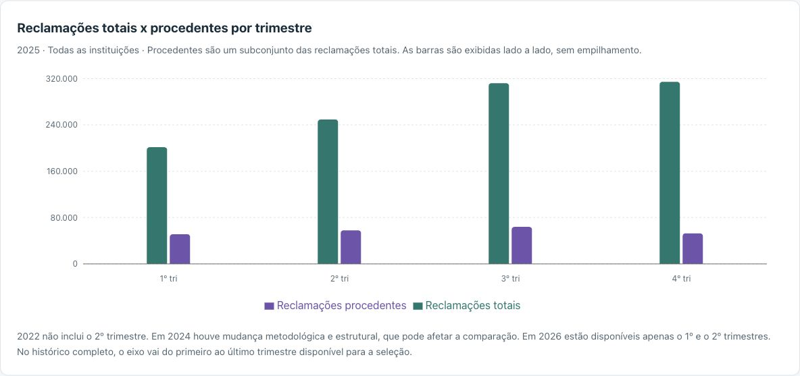

# Brazilian Banking Complaints Dashboard

**Interactive Data Visualization | React | TypeScript | Recharts**

I built this dashboard to explore banking complaints in Brazil using public data from the Central Bank of Brazil (BCB).

The application makes it easier to compare financial institutions, track complaint volumes over time, and understand how many complaints were considered substantiated.

**[View Live Dashboard](https://dashboard-reclamacoes-bcb.vercel.app/)**

## Dashboard Preview

### Historical Trends



Annual complaint volumes from 2017 to 2026.

### Top 10 Financial Institutions



Ranking of financial institutions by complaint volume.

### Quarterly Comparison



Comparison of total and substantiated complaints by quarter.

## Features

- Filter complaints by year and financial institution.
- Explore historical data from 2017 to Q2 2026.
- Monitor four KPIs: total complaints, substantiated complaints, substantiation rate, and year-over-year change.
- Compare institutions through interactive charts.
- Explore the dashboard on desktop and mobile devices.

## Technologies

- **React & TypeScript:** Application interface and data processing.
- **Recharts:** Interactive visualizations.
- **Papa Parse:** CSV data loading.
- **Vite:** Development and build tools.
- **Vercel:** Application hosting.

## Data and Methodology

The dashboard uses a consolidated CSV containing **5,060 records** from the Central Bank of Brazil's public complaints ranking.

The dataset is stored locally in the application and is not updated automatically.

Some reporting periods are incomplete, and the BCB's data structure changed in 2024. For this reason, historical comparisons require care. The dashboard preserves missing values and compares equivalent quarters when calculating annual changes.

Complaint volumes are not adjusted for institution size and should not be interpreted as a direct ranking of service quality.

**Related project:** [Banking Complaints Data Analysis](https://github.com/thalesfreirefarias/churn-bancario-brasil)

## Run Locally

Requires Node.js 24.x and npm.

```bash
git clone https://github.com/thalesfreirefarias/dashboard-reclamacoes-bcb.git
cd dashboard-reclamacoes-bcb/dashboard
npm install
npm run dev
```

To run the project's checks:

```bash
npm run test
npm run lint
npm run build
```

## Development Notes

I worked on turning historical banking data into an interactive application, with particular attention to filtering, KPI calculations, missing values, and comparisons between reporting periods.

Codex was used to assist with implementation, testing, and documentation.

## Author

**Thales Farias**

Data Analytics | Business Intelligence | Financial Services

[GitHub](https://github.com/thalesfreirefarias)
